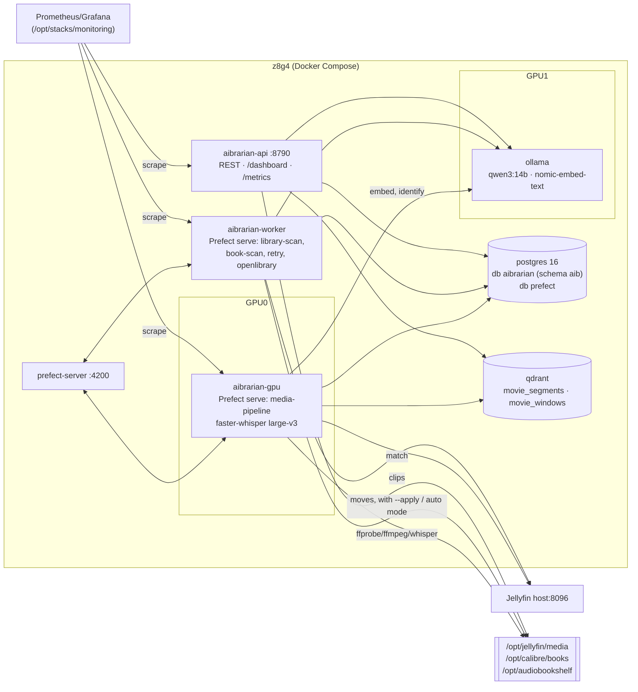

# Architecture

## Overview

## Components

| Component | Image | Role |
|---|---|---|
| `aibrarian-api` | `docker/Dockerfile` | One FastAPI app. It replaces the librarian (:8787), book-librarian (:8788), catalog-api (:8790) and clipper (:8791). Those old ports are still mapped to it for compatibility. |
| `aibrarian-gpu` | `docker/Dockerfile.gpu` (CUDA 12.8 + cuDNN 9) | Prefect `serve` process for the **media pipeline**. It is the only process that loads whisper, pinned to GPU0. |
| `aibrarian-worker` | `docker/Dockerfile` | Prefect `serve` process for the librarian scans and maintenance flows. |
| `prefect-server` | `prefecthq/prefect:3-python3.12` | Scheduling, run history, retries and the UI. Its database lives in the shared Postgres. |
| `postgres` | `postgres:16` | Catalog, state machine, events, suggestions, file-op audit and Open Library editions, all in schema `aib`. Prefect has its own database on the same server. |
| `qdrant` | `qdrant/qdrant` | Vectors. The `movie_segments` collection is line-level; `movie_windows` holds sliding scene windows. |
| `ollama` | `ollama/ollama` | LLM and embeddings on GPU1. |

## Package layout (`src/aibrarian`)

| Module | Responsibility |
|---|---|
| `config` | `Settings` (pydantic-settings). Reads `AIB_*` env vars and also accepts the legacy names (`OLLAMA_URL`, `QDRANT_COLLECTION`, `BOOK_MIN_CONFIDENCE`, …). |
| `status` | The pure state machine: stages, `ActionSpec` (requires → produces, resource tag) and transition validation. |
| `db` + `migrations/` | psycopg 3 repository and a tiny SQL migration runner (protected by an advisory lock). It handles atomic stage transitions with event rows and `SKIP LOCKED` claiming. |
| `actions` | **Single-purpose idempotent actions**: `probe`, `extract_audio`, `transcribe`, `embed`, `catalog`, plus the non-per-item `discover`. `run_action()` does all bookkeeping. |
| `flows` | Prefect tasks (one per action, tagged with its resource) and the flows that compose them. |
| `media`, `probe`, `sidecars` | Filesystem walk, fingerprints, filename parsing, ffprobe/ffmpeg/mutagen, `.srt`/`.transcript.json` sidecars and the SRT catalogue. |
| `transcribe`, `windows` | faster-whisper wrapper (with word timestamps), ~30 s chunking, sliding windows. |
| `ollama`, `vectors`, `jellyfin` | Thin HTTP clients (httpx). Qdrant is reached over REST, so there is no heavy client dependency. |
| `video_librarian`, `books`, `openlibrary` | Identification, matching, canonical placement and confidence decisions. Open Library import and lookup. |
| `fileops` | Safe moves and renames that carry sidecars along. Dry-run by default, audited to `aib.file_op` and JSONL. Duplicate cleanup and subtitle repair. |
| `search`, `clips`, `services` | Hybrid search (reciprocal-rank fusion of Qdrant and pg_trgm/FTS), quote → clip, and higher-level operations. |
| `api`, `dashboard`, `metrics`, `logging_setup`, `cli`, `gendocs` | Interfaces and observability. |

## Data flow (one video)

1. **discover**: the filesystem walk over `AIB_TRANSCRIBE_ROOTS` upserts `aib.media_file`. A new file, or one whose fingerprint changed (size + mtime + 1 MiB head/tail hash), goes to `discovered`.
2. **probe**: ffprobe stores a compact summary and the duration. Files with no audio stream go to `skipped`.
3. **extract_audio**: ffmpeg writes a 16 kHz mono WAV on CPU, so GPU0 only does inference. This step is a no-op when a valid sidecar already exists.
4. **transcribe**: whisper large-v3-turbo (VAD, word timestamps), or a reused sidecar. Segments are merged into ~30 s chunks and saved to `aib.segment`; the sidecars are written and the WAV is deleted.
5. **embed**: `nomic-embed-text` embeds the chunks (with a `search_document:` prefix) into `movie_segments`, using point id = segment id and payload `movie_id`. Windows go into `movie_windows`.
6. **catalog**: the LLM identifies the file using the old strict `MEDIA_SCHEMA`. That result is matched against Jellyfin and stored as a placement suggestion. The item goes to `cataloged` if confident, otherwise to `needs_review`.

Each step is one Prefect task run and one `aib.media_event` row. See [status-model.md](status-model.md).

## Key design decisions

### One package, one image per hardware class
The old stack bind-mounted scripts and ran `pip install` at every container start. Now dependencies are baked into wheels at build time. There are only two images: CPU, and GPU (CUDA). The CLI, API and workers all share the same code.

### Small idempotent actions + a Postgres state machine; Prefect only orchestrates
The truth about each item lives in Postgres (`stage`, `stage_attempts`, `failed_stage`, `last_error`, events), not in Prefect. Because of that:
- any flow can be killed and re-run. A run only touches items still in the action's input stage, and transitions are guarded (`UPDATE … WHERE stage = expected`), so racing workers can't double-apply;
- you can run actions without Prefect (`aibrarian run-action`, `aibrarian pipeline`, `POST /media/{id}/actions/{action}`);
- Prefect still provides schedules, retries (`retries=2`, delays of 30 s and 120 s), the run UI and **tag concurrency limits**. Tag `gpu-whisper` is limited to 1, so exactly one whisper job runs on GPU0; `gpu-ollama` is limited to 2, `cpu` to 4 and `io` to 8 (`aibrarian prefect-limits`). Every event row records the Prefect flow and task run ids.

### Neo4j: removed
Neo4j held the librarian's report graph (`MediaFile`, `Directory`, `ScanRun`, `LOCATED_IN`, `SHOULD_BELONG_IN`, `PARSED_AS`). Every one of those relationships is a foreign key or a column. A file's directory is part of its path, its target is `suggestion.target_path`, and its parse is `suggestion.metadata.parsed`. Scan runs are `aib.scan_run`. Nothing ran graph algorithms or multi-hop traversals on it, and it was a second source of truth that had to be kept in sync from JSON reports. Dropping it removes a JVM service (about 1–2 GB RAM), a password and an ingest script. If graph exploration is ever wanted, the relational data can be exported to Memgraph or Neo4j in one query. The devtools profile already runs Memgraph for the *code* graph.

### Redis: removed
Redis existed only for Prefect. Prefect 3's server runs its messaging and caching in-process when one server instance is used, which is the case here. Redis is only needed to scale Prefect's API horizontally or run its services separately. One server on one host doesn't need that, so Redis is gone. To add it back later, set `PREFECT_MESSAGING_BROKER=prefect_redis.messaging` and `PREFECT_MESSAGING_CACHE=prefect_redis.messaging` and add a Redis service (see Prefect's self-hosting docs).

### One Postgres, one schema
The old `movie_catalog` and `openlibrary` databases and the DuckDB `openlibrary.duckdb` are merged into `aibrarian` / schema `aib`. Prefect keeps its own database on the same server. pg_trgm handles fuzzy title and segment search (the same behaviour as old `catalog_db.find_by_title` and `search_text`), and a generated `tsvector` adds full-text search.

### Compatibility kept on purpose
- Qdrant collection `movie_segments` (768-dim, cosine) and `movie_windows`, with the same point/payload contract (point id = segment id, payload `movie_id`). This means old clients of the vector store keep working. The ids are new, though, so a re-embed is required (see migration).
- Old catalog-api routes and query params (`/movies`, `/movies/lookup`, `/movies/by-path`, `/movies/{id}/location`, `/movies/{id}/segments`, `/search/text`, `/search/semantic`), plus `/scan`, `/report/latest`, `/book-scan`, `/book-suggestions` and `/clip`.
- Sidecars `<video>.transcript.json` and `<video>.srt` next to the video. Legacy sidecars are reused, so the library is **not** re-transcribed.
- The same LLM prompt, schema and confidence math as `librarian.py`, and the same book thresholds (0.85 / 0.60).

### Suggest first, move later
Neither librarian moves anything unless you ask. Video placement is always a suggestion; books auto-move only in `AIB_BOOK_MODE=auto` at ≥ 0.85. Moves:
- refuse to overwrite (`skip_dst_exists`);
- stay inside the allowed roots;
- carry all sidecars along, which fixes the "subtitles left behind" problem that `sync_srt_to_media_from_logs.py` used to patch;
- remove empty source directories;
- write every operation to `aib.file_op` and `/data/reports/file_ops.jsonl`.

### Observability
- **Status**: `/status` returns counts per stage, backlog and ETA. Also `/status/stages/{stage}`, `/status/events`, `/status/durations` (avg/p95 per action) and `/media/{id}/timeline`.
- **Dashboard**: `/dashboard` is a dependency-free HTML page that polls those endpoints.
- **Metrics**: Prometheus. The API serves stage gauges computed from Postgres at scrape time. Workers expose `aib_action_total{action,outcome}` and `aib_action_duration_seconds` on ports 9108 and 9109. An importable Grafana dashboard lives in `monitoring/grafana/aibrarian-overview.json` and a scrape snippet in `monitoring/prometheus/aibrarian-scrape.yml`. Grafana isn't added to this compose file because z8g4 already runs Prometheus and Grafana in `/opt/stacks/monitoring`, and port 3000 is taken.
- **Logs**: one JSON object per line on stdout. Fields: `ts`, `level`, `service`, `logger`, `msg`, plus `media_id`, `action`, `outcome` and `duration_s` where relevant.
