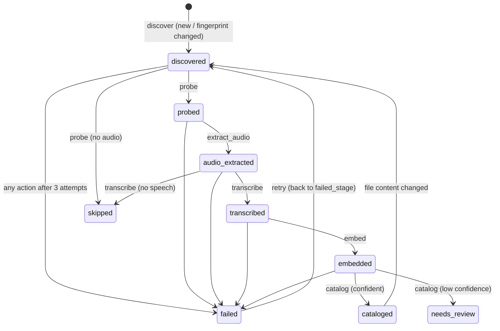

# Media status model

Every video in the transcribe roots is a row in `aib.media_file`, and its
`stage` column says where it is in the pipeline. Every attempt to move an item
forward appends a row to `aib.media_event`. Postgres is the source of truth;
Prefect holds runs, not item state.

## States



| Stage | Meaning | Next action | Resource tag |
|---|---|---|---|
| `discovered` | registered, nothing done yet | `probe` | `io` |
| `probed` | ffprobe stored (duration, streams) | `extract_audio` | `cpu` |
| `audio_extracted` | 16 kHz WAV ready, or a valid sidecar exists | `transcribe` | `gpu-whisper` |
| `transcribed` | segments in Postgres, sidecars written | `embed` | `gpu-ollama` |
| `embedded` | vectors in `movie_segments` + `movie_windows` | `catalog` | `gpu-ollama` |
| `cataloged` | identified, Jellyfin-matched, placement suggestion recorded | none | |
| `needs_review` | identification below `video_min_confidence` (0.85); check `/suggestions` | manual | |
| `skipped` | nothing to do (no audio stream, no speech) | none | |
| `failed` | an action failed `MAX_ATTEMPTS` (3) times; `failed_stage` remembers where | `retry` | |

Columns on `aib.media_file`: `stage`, `stage_attempts` (failures in the
current stage), `failed_stage`, `last_error`, `stage_changed_at`,
`locked_by` / `locked_at` (worker lease, expires after 6 h).

Changing a file (its fingerprint changes) puts it back to `discovered` with an
`outcome='reset'` event, so it is reprocessed end to end.

## Events (`aib.media_event`)

| column | |
|---|---|
| `media_id`, `action` | which item, which action (`discover`, `probe`, …, `retry`) |
| `from_stage`, `to_stage` | the transition. For a failed attempt that will be retried, both are the same |
| `outcome` | `ok`, `failed`, `skipped`, `needs_review` or `reset` |
| `attempt` | 1-based attempt number within the stage |
| `started_at`, `finished_at`, `duration_ms` (generated) | timing |
| `error` | exception type + message (truncated to 4000 characters) |
| `details` (jsonb) | action output, e.g. `{"segments": 212, "language": "en", "reused_sidecar": false}` |
| `flow_run_id`, `task_run_id` | Prefect ids, so you can jump from an event to the run in the UI |

The table is append-only. Rows are deleted only when their media row is deleted.

## How an action runs (`actions.run_action`)

1. Load the item. If it isn't in the action's `requires` stage, return `noop`. This is what makes re-runs and duplicate submissions harmless.
2. Run the action body. Bodies are idempotent: they overwrite or upsert their outputs and use temp-file + rename for WAVs and sidecars.
3. **Success**: in one transaction, `UPDATE media_file SET stage=… WHERE id=… AND stage=<requires>` and insert an event. If the guarded update matches 0 rows, another worker won, and the result is `raced`.
4. **Exception**: `attempt = stage_attempts + 1`.
   - If `attempt < 3`, increment `stage_attempts`, log a `failed` event with the stage unchanged, and raise `RetryableError`. Prefect retries the task after 30 s, then 120 s.
   - If `attempt == 3`, move to `failed` with `failed_stage` set and return normally, so the flow continues with other items.
5. Prometheus counters and histograms are updated and a JSON log line is written.

`POST /media/{id}/retry`, `aibrarian retry-failed [--id N]`, or the
`retry-failed` deployment move failed items back to their `failed_stage` with
`stage_attempts=0` and a `retry` event.

## Concurrency

- **Claiming**: `db.claim(stage, roots, limit, worker)` uses `FOR UPDATE SKIP LOCKED` plus a lease, so two flows never take the same item.
- **GPU**: Prefect tag concurrency limits allow `gpu-whisper=1` (one whisper job on GPU0) and `gpu-ollama=2`. Create them once with `aibrarian prefect-limits`.
- **Batching**: `media-pipeline` runs every `AIB_TRANSCRIBE_INTERVAL_S` (300 s). Per run it handles up to `5×10` probes, `5×2` extractions, `5` transcriptions and `5×4` embeds and catalogs. Leftovers wait for the next run.

## Observability surface

| Endpoint / metric | What |
|---|---|
| `GET /status` | `{"stages": {...}, "backlog": N, "eta": {...}}`. The ETA uses the median gap between successful `transcribe` events and ignores gaps over 6 h (the old `movie_eta.py` logic) |
| `GET /status/stages/{stage}?limit=&offset=` | items in a stage, with `last_error`, `failed_stage` and attempts |
| `GET /status/events?outcome=failed` | recent events across all items |
| `GET /status/durations?hours=24` | count, avg and p95 `duration_ms` per action and outcome |
| `GET /media/{id}/timeline` | item + full event history |
| `GET /dashboard` | HTML view of all of the above (auto-refresh 15 s; click a stage card or a row to drill down) |
| `aib_media_items{stage}` | gauge (API, computed from Postgres at scrape time) |
| `aib_backlog_items` | gauge |
| `aib_suggestions_open{domain}` | gauge |
| `aib_action_total{action,outcome}` | counter (workers on :9108 / :9109) |
| `aib_action_duration_seconds{action}` | histogram |

Example SQL:

```sql
-- where is everything?
SELECT stage, count(*) FROM aib.media_file WHERE NOT missing GROUP BY 1;
-- slowest transcriptions today
SELECT m.path, e.duration_ms/1000 AS s FROM aib.media_event e JOIN aib.media_file m ON m.id=e.media_id
 WHERE e.action='transcribe' AND e.outcome='ok' AND e.finished_at > now()-interval '1 day'
 ORDER BY e.duration_ms DESC LIMIT 10;
-- top errors
SELECT left(error, 120) AS err, count(*) FROM aib.media_event WHERE outcome='failed' GROUP BY 1 ORDER BY 2 DESC;
```

Books and the library-wide scan (`library-scan`, `book-scan`) are batch jobs
rather than per-item pipelines. Their progress is tracked in `aib.scan_run`
(params, summary, Prefect flow run id) and `aib.suggestion` (one row per file,
with `status` open, applied, dismissed or failed). That is what lets an
interrupted scan resume where it stopped.
